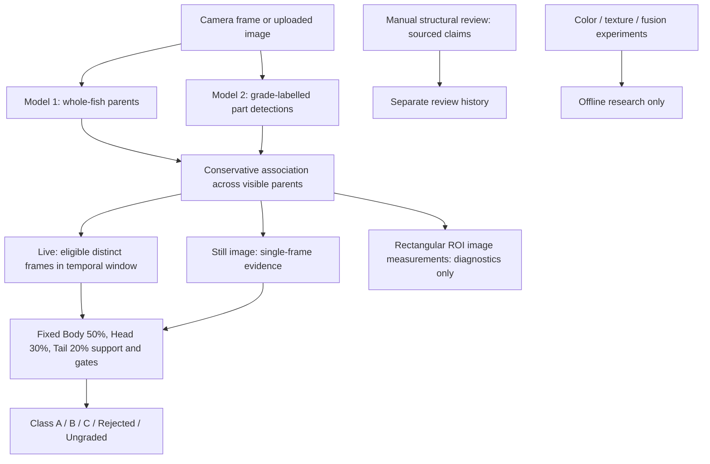

# Research architecture and methods status

This describes the checked repository state on 2026-10-17. It is not a claim of
fish-level accuracy or proof that the part weights are optimal.



Live evidence requires sufficient reliable observations; ambiguity clears the
active history and eligible later frames can recover. Unobserved anatomy does
not prove physical absence. Missing regions contribute zero without changing
the original weights. The shipped `standard` policy requires Body and original
coverage; the stricter `two_part_v1` is opt-in and awaits expert approval.
Rejected uses Model 2 trained `Rejected_*` labels; Ungraded means the evidence
or acceptance gates did not justify a verdict.

The live color measurements use bounding rectangles that can include background,
not validated fish masks. Offline color and texture studies use separately
prepared masked fish images and remain unvalidated. E0 fusion replay preserves
the baseline; E1/E2 require a separately fitted and frozen artifact, and E3/E4
remain blocked. No fusion candidate is wired into the live verdict. The belly
rubric is a draft and there is no validated belly-defect detector.

The original training splits and inspected part annotations do not constitute
an independent, blind, fish-level validation study. Follow the
[independent validation protocol](independent_validation_protocol.md) and the
[current preflight](validation_preflight/report.md) before reporting performance.
The [feature inventory](feature_inventory.md) covers measurement provenance.

## Local API examples

```powershell
Invoke-RestMethod http://localhost:8000/api/status
Invoke-RestMethod http://localhost:8000/api/models
Invoke-RestMethod http://localhost:8000/api/reviews/1/structure

# Change the shared model only after stopping inspection.
Invoke-RestMethod -Method Post -Uri http://localhost:8000/api/models/select `
  -ContentType 'application/json' -Body '{"model_id":"yolo26m_partdet"}'

# A still image can be analyzed without switching the active model.
Invoke-RestMethod -Method Post -Uri http://localhost:8000/api/analyze-image `
  -Headers @{'X-Filename'='fish.jpg'} -ContentType 'image/jpeg' `
  -InFile 'C:\path\to\fish.jpg'
```

The structural review route applies to an existing counted track. Expert
identity in a review is recorded, not authenticated. The optional expert clip
library is disabled by default: see [access limitations](expert_validation_library.md).
The model-change guard is process-local; a single API process must own the camera.
